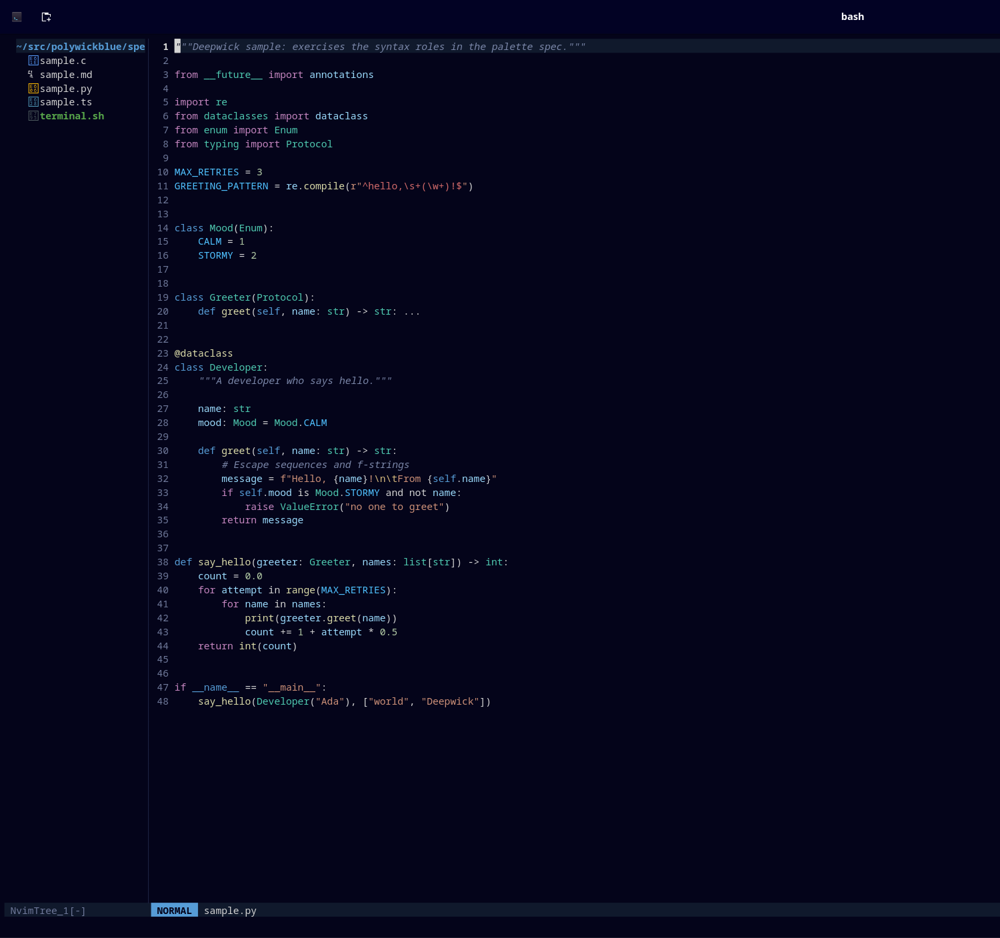

# Deepwick for Neovim

A deep navy colorscheme with Visual Studio 2022's syntax colors, for Neovim
0.10 and later.

> Deepwick is an unofficial theme derived from
> [Polywick Blue](https://vscode.polywickstudio.net) by Polywick Studio (MIT).
> Not affiliated with Polywick Studio.



## Install

With `vim.pack` (Neovim 0.12):

```lua
vim.pack.add({ "https://github.com/deepwick/neovim" })
vim.cmd.colorscheme("deepwick")
```

With [lazy.nvim](https://github.com/folke/lazy.nvim):

```lua
{
  "deepwick/neovim",
  name = "deepwick",
  lazy = false,
  priority = 1000,
  config = function()
    vim.cmd.colorscheme("deepwick")
  end,
}
```

Deepwick sets `termguicolors` and `background=dark` when loaded.

## What's covered

- Editor UI, floats, popup menu, search, diffs, spelling
- Legacy syntax groups, Tree-sitter captures, LSP semantic tokens, diagnostics
- Terminal colors (`terminal_color_0` … `terminal_color_15`)
- Plugins: gitsigns, telescope, nvim-tree

## Statuslines

lualine:

```lua
require("lualine").setup({ options = { theme = "deepwick" } })
```

vim-airline:

```vim
let g:airline_theme = 'deepwick'
```

## Notes

- `#include` and other C/C++ preprocessor keywords are Foreground, matching
  Visual Studio; imports in other languages are Magenta.
- Python builtin types (`str`, `int`) are Teal like other classes; C/C++
  builtin types (`int`, `char`) are Blue keywords.
- Python's `and`, `or`, `not`, and `is` are Foreground (operators), while
  `typeof`, `instanceof`, and `new` in other languages are Magenta.
- Tree-sitter `@punctuation.special` (for example `${` in template strings)
  is Foreground.

Tested with Neovim 0.12.5.

## License

MIT. See [LICENSE](LICENSE).
